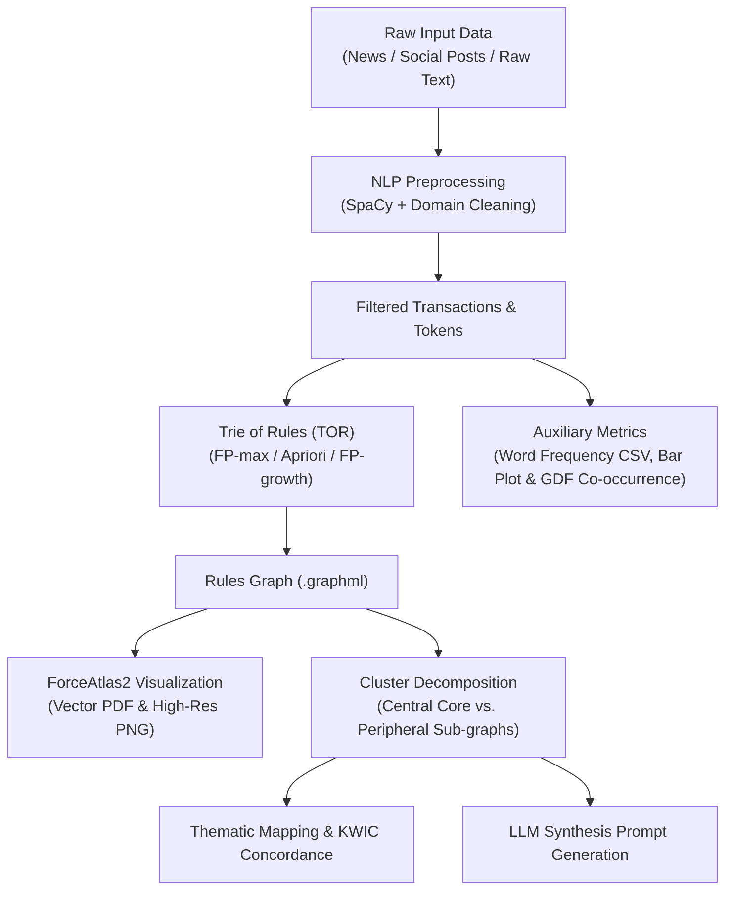

# Pre-Processing-ToR

<p align="center">
  
  
  
  
  
</p>

> **A modular Natural Language Processing (NLP) pipeline for Association Rule Mining (ARM) and semantic network visualization powered by the Trie of Rules (TOR) data structure.**

---

## 📌 Overview

**Pre-Processing-ToR** is an end-to-end Python framework designed to extract, discover, and visualize semantic associations and conceptual patterns across unstructured textual datasets (specifically in Portuguese). By combining **Association Rule Mining (ARM)** algorithms with a prefix-tree representation (**Trie of Rules - TOR**), the framework maps conceptual networks, separates central core topics from peripheral subthemes, and facilitates downstream analysis such as text summarization and automated prompt engineering for Large Language Models (LLMs).

The project natively supports multiple data modalities:
* **Journalistic News Articles**: Document and paragraph-level segmentation, Named Entity Recognition (NER), numerical entity matching, Key-Word-In-Context (KWIC) concordance, and rule-density-based article recommendation.
* **Social Media (Twitter / X)**: Social-specific sanitation (removal of URLs, `@mentions`, `#hashtags`, and emojis), informal abbreviation normalization, post-to-cluster mapping, and LLM synthesis prompt generation.
* **Arbitrary Free Text**: A standalone CLI utility that converts any raw text directly into a publication-ready network diagram in **PDF** format without touching cluster structures.

---

## 🚀 Key Features

- **Domain-Specific NLP Preprocessing (SpaCy)**:
  - Multi-pattern `Matcher` for compound expressions (e.g., numbers with quantifiers like *"20 mil pessoas"*, dates, ordinals).
  - Web/Social cleaner: strips URLs, mentions, emojis, and normalizes slang and common abbreviations (*tb*, *pq*, *vc*, etc.).
  - Robust Portuguese stopwords filtering with offline fallback support.

- **Association Rule Mining & Trie of Rules (TOR)**:
  - Integrated ARM algorithms: `FP-max`, `Apriori`, and `FP-growth` (via `mlxtend`).
  - Hierarchical prefix-tree construction annotating rule metrics: **support**, **confidence**, and **lift**.

- **Publication-Ready Network Visualizations**:
  - Force-directed layout combining **ForceAtlas2** and **Spring Layout** (Gephi-compatible visual aesthetics).
  - Node sizes mapped linearly to support; color gradients mapped to rule confidence.
  - Export directly to vector **PDF** and high-resolution **PNG**.

- **Network & Semantic Analytics**:
  - **Cluster Decomposition**: Automatic partitioning into central core vs. peripheral sub-clusters.
  - **Topic Branch Extraction**: Traces conceptual paths from root terms to leaf tokens.
  - **Document-to-Cluster Mapping**: Links original texts/tweets to their corresponding rule clusters.
  - **KWIC Concordance Analysis**: Aligns target keyword occurrences with surrounding context.
  - **Rule-Density Text Recommendation**: Identifies the single most informative and concise article matching discovered rules.
  - **Automated LLM Prompts**: Generates structured prompts to summarize each cluster using AI.
  - **Auxiliary Artifacts**: Word frequency rankings (CSV), frequency bar plots, and co-occurrence graphs (`.gdf` for Gephi).

---

## 🗂️ Repository Structure

```plaintext
Pre-Processing-ToR/
├── datasets/                     # Input datasets (.csv)
├── utils/                        # Core utilities and pipeline functions
│   ├── pipeline.py               # Shared orchestration routines (DRY architecture)
│   ├── pre_processing_news.py    # News text preprocessing and tokenization
│   ├── pre_processing_social_media.py # Social media cleaner and tokenizer
│   ├── analize_tor.py            # Cluster extraction, concordance, and LLM prompt generation
│   ├── processing_file.py        # ForceAtlas2 graph drawing to PDF/PNG
│   ├── other_visualizations.py   # Word rankings and co-occurrence graph exporter (.gdf)
│   └── io_helpers.py             # CSV read/write helpers
├── trieofrules/                  # Trie of Rules (TOR) core package
│   ├── __init__.py               # Tree construction and graph metrics
│   └── arm.py                    # Association rule mining algorithms
├── tor_text.py                   # ⭐ Standalone CLI: Raw text to TOR PDF (no clusters)
├── tor_text.bat                  # ⭐ Windows batch shortcut for tor_text.py
├── main.py                       # ⭐ Unified CLI dispatcher (news, social, text)
├── main_news.py                  # Standalone script for news pipeline
├── main_social_media.py          # Standalone script for social media pipeline
├── main_news.ipynb               # Interactive Jupyter notebook for news
├── main_social_media.ipynb       # Interactive Jupyter notebook for social media
├── processing_database.ipynb     # Database cleaning and temporal filtering notebook
├── requirements.txt              # Project package dependencies
└── README.md                     # Documentation
```

---

## ⚙️ Installation & Setup

### 1. Clone the Repository
```bash
git clone git@github.com:luiza-bolonha/Pre-Processing-ToR.git
cd Pre-Processing-ToR
```

### 2. Set Up a Virtual Environment (Recommended)
```bash
# Windows
python -m venv venv
.\venv\Scripts\activate

# Linux / macOS
python3 -m venv venv
source venv/bin/activate
```

### 3. Install Dependencies
```bash
pip install -r requirements.txt
```

### 4. Download the Portuguese SpaCy Model
```bash
python -m spacy download pt_core_news_lg
```

---

## 💻 Usage Guide

### 1. Standalone Raw Text to PDF Tool (`tor_text.py`)
Quickly generates a Trie of Rules and exports a visual **PDF** from any input text **without creating or modifying clusters**:

```bash
# Direct inline text argument:
python tor_text.py --text "Artificial intelligence transforms healthcare. Data science and artificial intelligence accelerate medical discovery." --min-support 0.3 --output "outputs/my_tor.pdf"

# From a text file (.txt or .csv):
python tor_text.py --file "datasets/sample.txt" --min-support 0.05

# Interactive prompt (type or paste text in terminal):
python tor_text.py
```

*On Windows, you can also launch `.\tor_text.bat` directly.*

#### Available CLI Arguments:
| Argument | Type | Default | Description |
| :--- | :--- | :--- | :--- |
| `-t`, `--text` | `str` | `None` | Raw text string to process |
| `-f`, `--file` | `str` | `None` | Path to text file to read |
| `-o`, `--output` | `str` | `outputs/tor_texto_<date>.pdf` | Destination PDF path |
| `--png` | `str` | `None` | Optional path to export a PNG image |
| `-s`, `--min-support` | `float` | `0.05` | Minimum support threshold for ARM |
| `-a`, `--alg` | `str` | `FP-max` | Algorithm (`FP-max`, `Apriori`, or `FP-growth`) |
| `--split` | `str` | `paragrafos` | Transaction split mode (`paragrafos`, `frases`, or `linhas`) |
| `--show` | `flag` | `False` | Displays interactive Matplotlib plot window |

---

### 2. Unified Command-Line Interface (`main.py`)

Run complete pipelines directly from the terminal:

```bash
# News Article Pipeline:
python main.py news --file manifestacao_bolsonaro --alg FP-max --min-support 0.05

# Social Media Pipeline:
python main.py social --file vacinal_2025_05 --alg Apriori --min-support 0.009 --cluster-ia 10

# Free Text to PDF Mode:
python main.py text --text "Sample text..." --output "outputs/network.pdf"
```

---

### 3. Dedicated Scripts

You can also invoke domain modules directly:
* **News Articles:**
  ```bash
  python main_news.py --file manifestacao_bolsonaro --alg FP-max --min-support 0.05
  ```
* **Social Media (Tweets):**
  ```bash
  python main_social_media.py --file vacinal_2025_05 --alg Apriori --min-support 0.009
  ```

---

### 4. Interactive Jupyter Notebooks

For step-by-step exploratory analysis with inline visualizations:
* [`main_news.ipynb`](main_news.ipynb): Tailored for journalistic articles.
* [`main_social_media.ipynb`](main_social_media.ipynb): Tailored for social media posts.

Both notebooks are organized into standardized blocks with centralized configuration cells at the top.

---

## 📊 Pipeline Architecture



---

## 🌿 Branch Strategy

To ensure scientific reproducibility and preserve the project's historical evolution:

* **`main`**: Current, modularized version featuring CLI tooling, standalone text processing, and clean architecture.
* **`legacy`**: Preserves the original initial release of the repository.

---

## 👩‍💻 Author

Developed by **[Luiza Bolonha](https://github.com/luiza-bolonha)**.

If this repository was helpful for your research or project, feel free to give it a ⭐!
